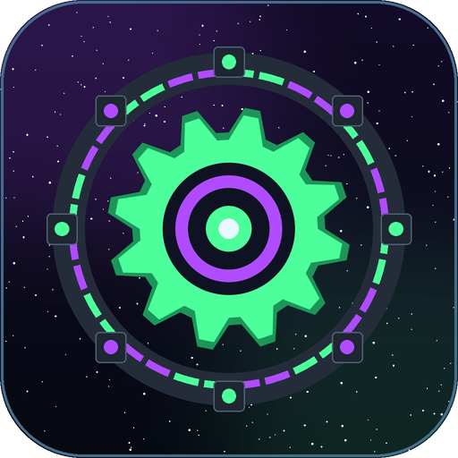
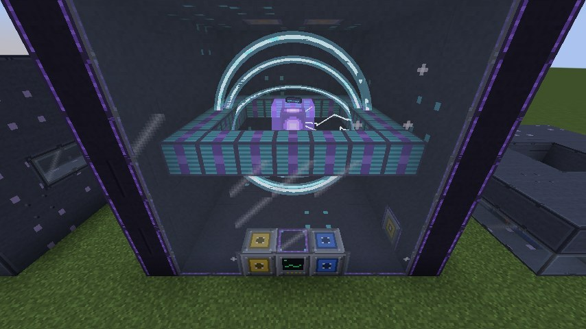
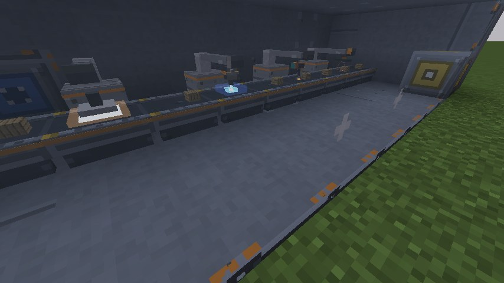
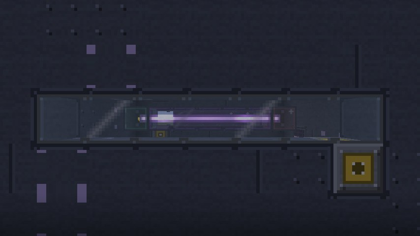
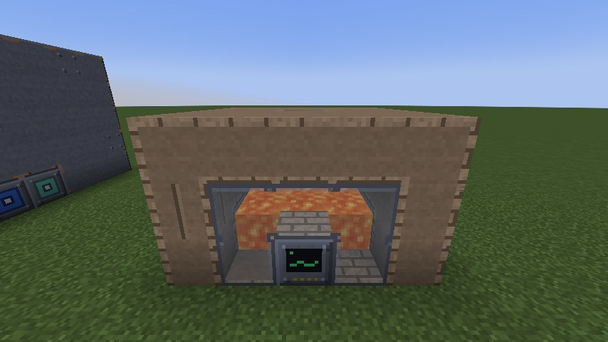
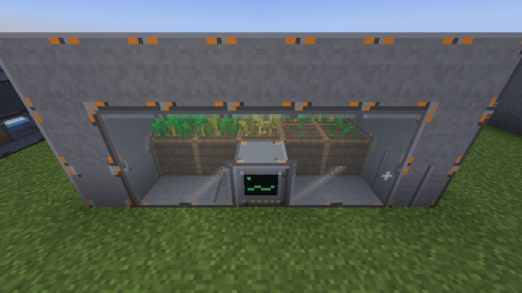
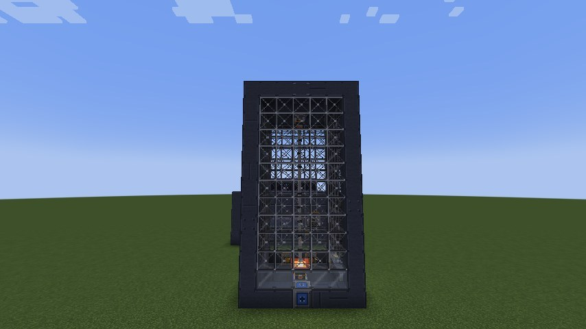

  

<h1 align="center">QuantaWorks</h1>

  From raw matter to advanced industry: universal processing, automated production, agriculture and multiblock 
  manufacturing that gives extraordinary power a purpose. For Fabric and NeoForge.

  <a href="#downloads">Download</a> ·
  <a href="#version-status">Versions</a> ·
  <a href="../../wiki">Wiki</a> ·
  <a href="#part-of-the-quantanetwork">QuantaNetwork</a> ·
  <a href="api/README.md">API for mod developers</a> ·
  <a href="#license">License</a>

> **0.1.0 – BETA.** The first release. Every machine, plant and recipe was tested on every supported Minecraft version
> and loader, and played by hand on 1.21.1. Please report anything odd on the [issue tracker](../../issues) with your
> Minecraft version, loader and log, and keep backups of your worlds.

This repository holds the documentation, the [wiki](../../wiki), the [issue tracker](../../issues) and the
[API for mod developers](api/README.md). The mod itself is downloaded from CurseForge (Modrinth follows later).
QuantaWorks is not open source; see [License](#license).

  
  
  
  
  
  

* **Processing for every mod's materials:** QuantaWorks reads the metals of your modpack from the common `c:` tags and
  makes its recipes for each of them – grinding, smelting, pressing, rolling, wire drawing, casting, leaching. A balance
  check after every data reload switches off recipe loops that would create material from nothing.
* **Eleven machines from the first ore to chemistry:** Pulverizer, Induction Furnace (every smelting recipe at half the
  time, alloys), Metal Former with dies, Plant Processor, Assembler with pattern cards, Air Separator, Chemical Reactor,
  Centrifuge, Crystallizer, Farming Station, Tree Harvester – with speed, efficiency, parallel, range and yield upgrades;
  and a Combustion Generator for packs without a power mod.
* **Eight multiblock plants you build block by block**, each with a step-by-step guide from the game in the
  [wiki](../../wiki): a Foundry that melts and alloys into one bath, a Chemical Plant with parallel reactor columns, an
  Assembly Complex with stations along a conveyor, an indoor Agricultural Facility, a Particle Facility ring, a Quantum
  Facility with its coherence field, a Matter Reconstructor and a Deep Core Extractor that brings up the ores of your
  dimension. A Build Projector shows every plan in the world.
* **A purpose for big power:** the endgame plants take hundreds of thousands to millions of E per tick and one-time
  investments of billions – made for [QuantaVolt](https://github.com/CptGummiball/QuantaVolt), but any mod's energy works.
* **You see the work:** machines and plants show what they do – rollers turning, the bath glowing, workpieces riding the
  conveyor, crops growing, the beam circling, the drill string turning – through the Industrial Viewport.
* **No world generation:** QuantaWorks adds no ores; it works with what your pack has.

| Machine | What it does |
|---|---|
| Industrial Pulverizer | ores, raw metals and ingots into dust (two dust per ore, with by-products) |
| Induction Furnace | every smelting recipe of every mod at half the time; steel and the alloys of your pack |
| Metal Former | plates, rods, gears, wires and blocks; the die chooses the process |
| Plant Processor | plant oil, bio slurry, plant fiber, bio fertilizer |
| Assembler | crafts any crafting recipe from a pattern card; circuits, coils, frames |
| Air Separator | nitrogen, oxygen and argon from the air |
| Chemical Reactor | electrolysis, fermentation, polymers, silicon, ammonia, nitric acid, liquid nitrogen |
| Industrial Centrifuge | dust and by-products from raw metals |
| Crystallizer | silicon boules, quartz, amethyst, quantum crystals |
| Farming Station, Tree Harvester | plant, harvest and replant fields and trees; respect claims |
| Combustion Generator | power for packs without a power mod (off when QuantaVolt is installed) |

**Upgrades:** Speed (up to 16 times as fast), Efficiency (−15 % power each), Parallel (2, 4 or 8 at once), Range and
Yield for the field machines. Details: [Machines](../../wiki/Machines), [Upgrades](../../wiki/Upgrades).

| Plant | Size | What it does |
|---|---|---|
| [Advanced Materials Foundry](../../wiki/Build-Foundry) | 5 × 4–8 × 5 | melts any metal into one bath, mixes alloys, casts ingots, plates, rods, gears, blocks and nuggets |
| [Chemical Processing Plant](../../wiki/Build-Chemical-Plant) | 7–11 × 6–10 × 7–11 | one reaction per reactor column at the same time, large processes, ore leaching |
| [Industrial Assembly Complex](../../wiki/Build-Assembly-Complex) | 5 × 4 × 6–22 | 2 – 10 stations along a conveyor; step recipes, precision assembly, automated crafting |
| [Agricultural Facility](../../wiki/Build-Agricultural-Facility) | 5–17 × 4–6 × 5–17 | crops and trees indoors in up to 64 beds, up to eight times as fast |
| [Particle Processing Facility](../../wiki/Build-Particle-Facility) | ring, edge 9–33 | exotic matter, charged quantum crystals, echo shards, nether stars |
| [Quantum Fabrication Facility](../../wiki/Build-Quantum-Facility) | 9 × 9 × 9 | a coherence field for quantum processors, field parts and upgrades |
| [Matter Reconstructor](../../wiki/Build-Matter-Reconstructor) | 7 × 7 × 11 | other metals into gold or iron, coal into diamonds, netherrack into netherite scrap – never a gain |
| [Deep Core Extractor](../../wiki/Build-Deep-Core) | 7 × 12–20 × 7 | brings up the ores of your dimension (every mod's too), from regional reserves |

Every plant has a build page with a picture of every layer from the game; the Build Projector shows the plan in the
world.

QuantaWorks belongs to the **QuantaNetwork** by cptgummiball:

* [Pipster](https://github.com/CptGummiball/Pipster): readable pipes for items, fluids, gases and energy.
* [QuantaVolt](https://github.com/CptGummiball/QuantaVolt): industrial power generation.
* [QuantaWorks](https://github.com/CptGummiball/QuantaWorks): from raw matter to advanced industry.
* [QuantaRift](https://github.com/CptGummiball/QuantaRift): endgame dimensional extraction.

The mods work together through public, standard interfaces. QuantaWorks itself needs only Pipster; QuantaVolt is
recommended, the others are optional.

* Items, fluids and energy use the **standard interfaces of the loader** (Fabric Transfer API and Team Reborn Energy;
  NeoForge capabilities). 1 E = 1 FE. Pipes, cables and storage of other mods connect without an extra integration.
* Gases (nitrogen, oxygen, argon, hydrogen, ethylene, ammonia) use the gas system of
  [Pipster](https://github.com/CptGummiball/Pipster), which is **required**.
* **[QuantaVolt](https://github.com/CptGummiball/QuantaVolt)** is recommended: hydrogen and oxygen become QuantaVolt's gases, its
  helium cools the Quantum Facility, and the QuantaWorks Combustion Generator steps aside.
* Optional integrations, only active when the other mod is installed: **JEI** (all machine recipes), **Jade** (machine
  status), **CC: Tweaked** (readings and redstone mode), **Open Parties and Claims** and **FTB Chunks** (farms respect
  claims). They were started with the real mods on every version where those mods exist; a few exceptions caused by the
  partner mods themselves are listed on [Supported Versions](../../wiki/Supported-Versions).
* Metals of other mods through the `c:` tags; checked with Tech Reborn (Fabric) and Mekanism (NeoForge). Mekanism's
  chemicals are a separate system and do not connect.

All files are **0.1.0**.

| Minecraft | Fabric jar | NeoForge jar |
|---|---|---|
| 1.21.1 | `quantaworks-0.1.0+mc1.21.1-fabric.jar` | `quantaworks-0.1.0+mc1.21.1-neoforge.jar` |
| 1.21.2 | `quantaworks-0.1.0+mc1.21.2-1.21.3-fabric.jar` | `quantaworks-0.1.0+mc1.21.2-1.21.3-neoforge.jar` |
| 1.21.3 | `quantaworks-0.1.0+mc1.21.2-1.21.3-fabric.jar` | `quantaworks-0.1.0+mc1.21.2-1.21.3-neoforge.jar` |
| 1.21.4 | `quantaworks-0.1.0+mc1.21.4-fabric.jar` | `quantaworks-0.1.0+mc1.21.4-neoforge.jar` |
| 1.21.5 | `quantaworks-0.1.0+mc1.21.5-fabric.jar` | `quantaworks-0.1.0+mc1.21.5-neoforge.jar` |
| 1.21.6 | `quantaworks-0.1.0+mc1.21.6-fabric.jar` | `quantaworks-0.1.0+mc1.21.6-neoforge.jar` |
| 1.21.7 | `quantaworks-0.1.0+mc1.21.7-1.21.8-fabric.jar` | `quantaworks-0.1.0+mc1.21.7-1.21.8-neoforge.jar` |
| 1.21.8 | `quantaworks-0.1.0+mc1.21.7-1.21.8-fabric.jar` | `quantaworks-0.1.0+mc1.21.7-1.21.8-neoforge.jar` |
| 1.21.9 | `quantaworks-0.1.0+mc1.21.9-1.21.10-fabric.jar` | `quantaworks-0.1.0+mc1.21.9-neoforge.jar` |
| 1.21.10 | `quantaworks-0.1.0+mc1.21.9-1.21.10-fabric.jar` | `quantaworks-0.1.0+mc1.21.10-neoforge.jar` |
| 1.21.11 | `quantaworks-0.1.0+mc1.21.11-fabric.jar` | `quantaworks-0.1.0+mc1.21.11-neoforge.jar` |
| 26.1 | `quantaworks-0.1.0+mc26.1-26.1.1-fabric.jar` | `quantaworks-0.1.0+mc26.1-26.1.1-neoforge.jar` |
| 26.1.1 | `quantaworks-0.1.0+mc26.1-26.1.1-fabric.jar` | `quantaworks-0.1.0+mc26.1-26.1.1-neoforge.jar` |
| 26.1.2 | `quantaworks-0.1.0+mc26.1.2-fabric.jar` | `quantaworks-0.1.0+mc26.1.2-neoforge.jar` |
| 26.2 | `quantaworks-0.1.0+mc26.2-fabric.jar` | `quantaworks-0.1.0+mc26.2-neoforge.jar` |
| 26.3 | `quantaworks-0.1.0+mc26.3-fabric.jar` | `quantaworks-0.1.0+mc26.3-neoforge.jar` |

"Tested" means, for every listed version: client and dedicated server started, all automated game
tests passed, and the integrations were started with the real mods. The exact loader versions are
listed in the wiki under [Supported Versions](../../wiki/Supported-Versions).

Measured on one laptop (Intel Core i7-13700H): a dedicated server with 12 running plants, 96 single machines and 8 field
machines cost QuantaWorks 0.20–0.39 ms per tick in the median and at most 1.3 ms in the 99th percentile (Minecraft 1.21.1
and 26.3, both loaders), out of 50 ms per tick. That is a measurement on that computer, not a promise for every server.
Details: [Performance](../../wiki/Performance).

[CurseForge](https://www.curseforge.com/minecraft/mc-mods/quantaworks/) – Modrinth follows later.

Please download QuantaWorks only from the official pages. Pick the file whose name contains your
Minecraft version, for your loader.

Please open an [issue](../../issues/new/choose) with the Minecraft version, the loader and its
version, the jar name, the other mods involved, and `logs/latest.log` (plus a crash report if
there is one).

QuantaWorks is **not open source**. All rights reserved by cptgummiball; see [`LICENSE`](LICENSE).
In short:

* You may play with QuantaWorks, use it on any server and show it in videos and streams.
* You may put QuantaWorks into **modpacks**, as long as the jar files stay exactly as published.
* You may **not** modify, decompile, re-upload or otherwise redistribute QuantaWorks, or use its
  assets elsewhere.
* Mod developers may compile against the [QuantaWorks API](api/README.md).
* For anything else, open a [permission request](../../issues/new?template=permission_request.yml).

QuantaWorks is made by **cptgummiball**. It is not an official Minecraft product and is not
associated with Mojang or Microsoft.
